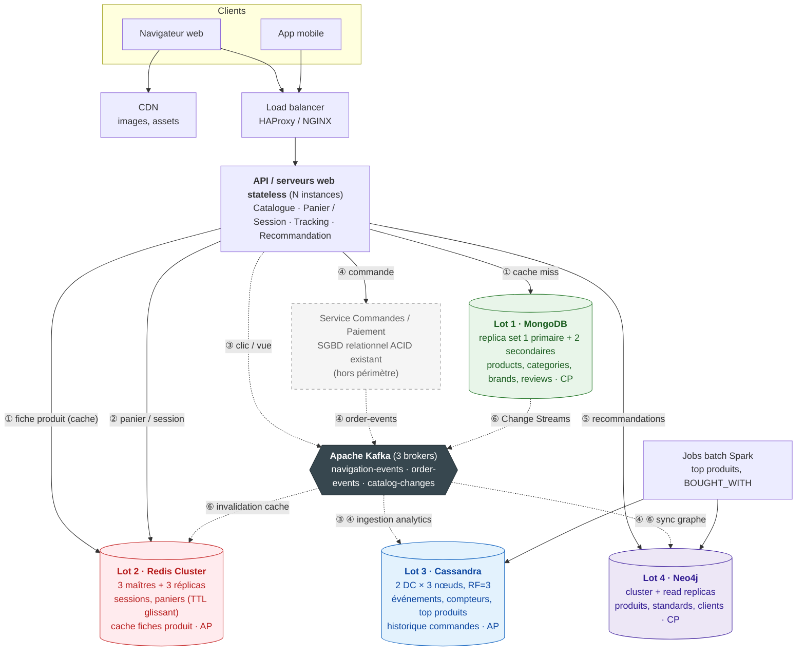

# Refonte NoSQL LDLC

> Une base par besoin : MongoDB (catalogue), Redis (paniers), Cassandra (logs et historique), Neo4j (recommandations) pour remplacer le monolithe relationnel de LDLC (27 000 références, millions de visites, 25 000 colis/jour).

## Membres du bi/trinôme

| Nom | Prénom |
|---|---|
|---|---|
|---|---|

## L'architecture en bref



Flux numérotés et légende : [docs/architecture.md](docs/architecture.md).

| Lot | Besoin | Techno | Pourquoi |
|---|---|---|---|
| 1 | Catalogue produits | **MongoDB 8** (document) | Fiches hétérogènes (specs par catégorie), facettes, lecture massive |
| 2 | Paniers et sessions | **Redis 7.4** (clé-valeur) | Latence sub-ms, TTL natifs, panier en Hash (`HINCRBY`) |
| 3 | Logs, analytics, historique commandes | **Cassandra 5.0** (colonnes larges) | Écritures massives, partitions par clé de requête, multi-datacenter |
| 4 | Recommandations | **Neo4j 5.26** (graphe) | Compatibilité et « achetés ensemble » = parcours de relations |

**CAP** : MongoDB (replica set) et Neo4j (cluster Raft) sont CP ; Redis Cluster est AP (réplication asynchrone, perte possible des dernières écritures au basculement, acceptable pour un panier) ; Cassandra est AP avec cohérence réglable par requête (`LOCAL_ONE` / `LOCAL_QUORUM`). Détail et chiffrage dans le document de conception.

## Livrables

| Livrable | Fichier |
|---|---|
| README (ce document) | [README.md](README.md) |
| Schéma d'architecture | [docs/architecture.md](docs/architecture.md) (Mermaid) |
| Document de conception | [docs/conception.md](docs/conception.md) : choix, schémas, compromis CAP et requêtes types par lot |
| Schémas de données | [MongoDB](db/mongodb/init.js) · [Cassandra](db/cassandra/schema.cql) · [Neo4j](db/neo4j/schema.cypher) · Redis : modèle de clés dans la conception (§4) |
| Requêtes types | [MongoDB](db/mongodb/queries.js) · [Redis](db/redis/queries.redis) · [Cassandra](db/cassandra/queries.cql) · [Neo4j](db/neo4j/queries.cypher) |
| Environnement local des 4 bases | [docker-compose.yml](docker-compose.yml) |

## Lancer les bases et les schémas

Prérequis : Docker et Docker Compose, environ 3 Go de RAM libres.

```bash
docker compose up -d        # 1er démarrage ≈ 2 min (Cassandra) ; les schémas sont appliqués par les jobs d'init
```

- Neo4j Browser : <http://localhost:7474> (`neo4j` / `ldlc-password`)
- Réinitialiser (efface les volumes) : `docker compose down -v`

## Exécuter les requêtes types

Depuis la racine du dépôt, bases démarrées :

```bash
docker compose cp db/mongodb/queries.js mongo:/tmp/q.js && docker compose exec -T mongo mongosh ldlc --quiet -f /tmp/q.js
grep -v '^#' db/redis/queries.redis | grep -v '^$' | docker compose exec -T redis redis-cli
docker compose exec -T cassandra cqlsh -k ldlc < db/cassandra/queries.cql
docker compose exec -T neo4j cypher-shell -u neo4j -p ldlc-password < db/neo4j/queries.cypher
```

Les requêtes s'exécutent sur les schémas vides ; les lectures renvoient des résultats une fois des données insérées (les exemples d'écriture de chaque fichier en créent puis les nettoient).

## Arborescence

```
.
├── README.md                 vitrine du projet
├── docker-compose.yml        mongo, redis, cassandra, neo4j (+ jobs d'init des schémas)
├── docs/                     architecture.md, conception.md
└── db/
    ├── mongodb/              init.js, queries.js
    ├── redis/                queries.redis
    ├── cassandra/            schema.cql, queries.cql
    └── neo4j/                schema.cypher, queries.cypher
```
