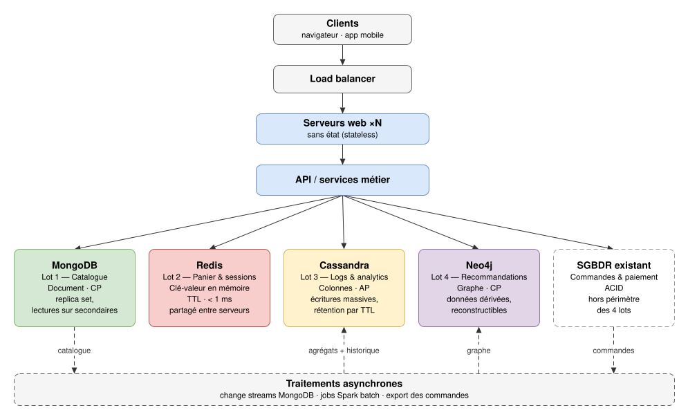

# Refonte LDLC — Architecture de données NoSQL

Projet NoSQL : concevoir l'architecture de données de la nouvelle plateforme e-commerce de LDLC
(27 000+ références, 600+ marques, millions de visites mensuelles, jusqu'à 25 000 colis/jour).

## Membres

- Owen Dias
- Romain Bories
- Lucas Magalhaes

## Architecture

Persistance polyglotte : une technologie par besoin.



Nous sommes partis d'une première intuition par lot, puis nous l'avons confrontée aux contraintes du sujet et aux alternatives
(démarche détaillée : [docs/choix-technologiques.md](docs/choix-technologiques.md)).

| Lot                   | Besoin                                               | Technologie pressentie | Technologie retenue | Position CAP |
| --------------------- | ---------------------------------------------------- | ---------------------- | ------------------- | ------------ |
| 1. Catalogue produits | Schémas variables, lecture intensive                 | MongoDB (document)     | **MongoDB**         | CP           |
| 2. Panier & sessions  | Latence submilliseconde, TTL, partage entre serveurs | Redis (clé-valeur)     | **Redis**           | AP           |
| 3. Logs & analytics   | Écritures massives, requêtes par partition           | Cassandra (colonnes)   | **Cassandra**       | AP           |
| 4. Recommandations    | Parcours de relations entre produits                 | Neo4j (graphe)         | **Neo4j**           | CP           |

Hors périmètre : la prise de commande et le paiement restent dans une base relationnelle (transactions ACID).

## Livrables

| #     | Livrable                              | Emplacement                                                                              |
| ----- | ------------------------------------- | ---------------------------------------------------------------------------------------- |
| —     | Sujet du projet                       | [docs/sujet.md](docs/sujet.md)                                                           |
| —     | Démarche des choix technologiques     | [docs/choix-technologiques.md](docs/choix-technologiques.md)                             |
| 1     | Schéma d'architecture globale         | [architecture/](architecture/README.md)                                                  |
| 2     | Conception Lot 1 — Catalogue produits | [docs/conception/lot1-catalogue-produits.md](docs/conception/lot1-catalogue-produits.md) |
| 3     | Conception Lot 2 — Panier & sessions  | [docs/conception/lot2-panier-sessions.md](docs/conception/lot2-panier-sessions.md)       |
| 4     | Conception Lot 3 — Logs & analytics   | [docs/conception/lot3-logs-analytics.md](docs/conception/lot3-logs-analytics.md)         |
| 5     | Conception Lot 4 — Recommandations    | [docs/conception/lot4-recommandations.md](docs/conception/lot4-recommandations.md)       |
| Bonus | Prototype d'API                       | [api/](api/)                                                                             |

## Structure du dépôt

```
.
├── README.md
├── CONTRIBUTING.md         # workflow git de l'équipe
├── docs/
│   ├── sujet.md            # énoncé du projet
│   ├── choix-technologiques.md  # démarche de choix par lot
│   └── conception/         # document de conception, un fichier par lot
├── architecture/           # schéma d'architecture globale
└── api/                    # prototype d'API (bonus)
```

## Contribuer

Voir [CONTRIBUTING.md](CONTRIBUTING.md) : branches par lot, PR vers `develop`, conventions de commit.
