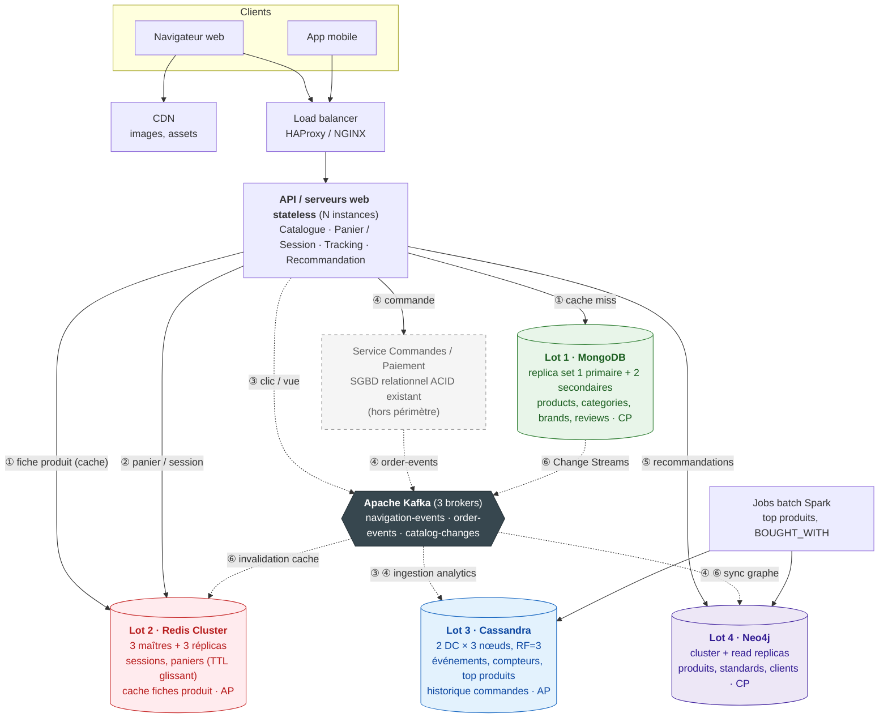
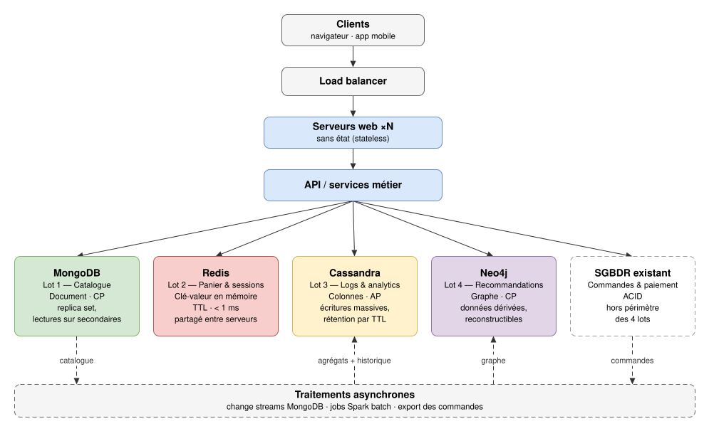

# Schéma d'architecture globale

Trait plein : appel synchrone. Pointillés : asynchrone (événements).

**Flux numérotés**

| Flux | Chemin |
|---|---|
| ① Fiche produit | API → cache Redis, sinon MongoDB (secondaire) |
| ② Panier / session | API ↔ Redis (TTL glissant, latence sub-ms) |
| ③ Clic / vue | API → Kafka `navigation-events` → Cassandra (asynchrone) |
| ④ Commande | API → service commandes → `order-events` → Cassandra (historique) + Neo4j (`PURCHASED`) |
| ⑤ Recommandations | API → Neo4j (read replicas) |
| ⑥ Évolution catalogue | Change Streams MongoDB → `catalog-changes` → Neo4j + invalidation du cache Redis |

## Vue simplifiée (draw.io)

Cette version est une vue simplifiée : le schéma Mermaid ci-dessus fait foi pour les flux et les composants.

## Lecture du schéma

**Flux synchrones (traits pleins)** : le parcours d'une requête utilisateur.

1. Le **CDN** sert les images et assets ; le **load balancer** répartit le reste du trafic entre plusieurs **serveurs web sans état** : aucun serveur ne garde de session en mémoire, on peut en ajouter ou en perdre un sans impact pour le client.
2. L'**API** interroge la base adaptée à chaque besoin :
   - fiche produit (①) : cache **Redis** d'abord, **MongoDB** (secondaire) seulement sur cache miss ;
   - panier, session (②) : **Redis** (TTL glissant), ce qui rend les serveurs web sans état ;
   - recommandations (⑤) : **Neo4j** (read replicas) ;
   - commande (④) : **service commandes / paiement** sur le SGBD relationnel existant (transactions ACID, hors périmètre).

**Flux asynchrones (pointillés)** : ce qui passe par **Kafka** et n'a pas besoin d'être immédiat.

- clics et vues (③) : l'API n'écrit pas directement dans Cassandra, elle publie sur `navigation-events` ; un consommateur alimente **Cassandra** ;
- commandes (④) : le service commandes écrit la commande et un message dans la même transaction ACID (**outbox**), qui est relayé vers `order-events` ; Cassandra (historique client) et Neo4j (`PURCHASED`, `BOUGHT_WITH`) le consomment ;
- évolutions du catalogue (⑥) : les Change Streams MongoDB alimentent `catalog-changes`, consommé par Neo4j (projection des produits) et par Redis (invalidation de la fiche en cache) ;
- des jobs batch Spark écrivent les agrégats (top produits, `BOUGHT_WITH`) dans Cassandra et Neo4j.

## Pourquoi ce découpage

- **Une base par besoin** (persistance polyglotte) : la démarche complète est dans [docs/choix-technologiques.md](../docs/choix-technologiques.md).
- **Chaque base a sa propre position CAP** : CP pour le catalogue et le graphe, AP pour le panier et les logs. Une panne d'une base n'arrête pas les autres : si Neo4j est indisponible, le site vend toujours, sans recommandations.
- **Les données dérivées sont asynchrones** : Neo4j et les agrégats peuvent avoir quelques minutes de retard sans conséquence métier, ce qui évite de ralentir le parcours d'achat.

## Modifier le schéma

Fichier `architecture-globale.drawio.svg` : c'est une image SVG qui contient aussi la source draw.io.

- VS Code : extension *Draw.io Integration* (`hediet.vscode-drawio`), ouvrir le fichier directement.
- Navigateur : https://app.diagrams.net → *Open Existing Diagram* → GitHub, ou glisser-déposer le fichier.
- Toujours enregistrer en `.drawio.svg`. Une seule personne modifie le fichier à la fois (le diff n'est pas lisible).

Les schémas de chaque lot sont en Mermaid, directement dans [docs/conception/](../docs/conception/).
