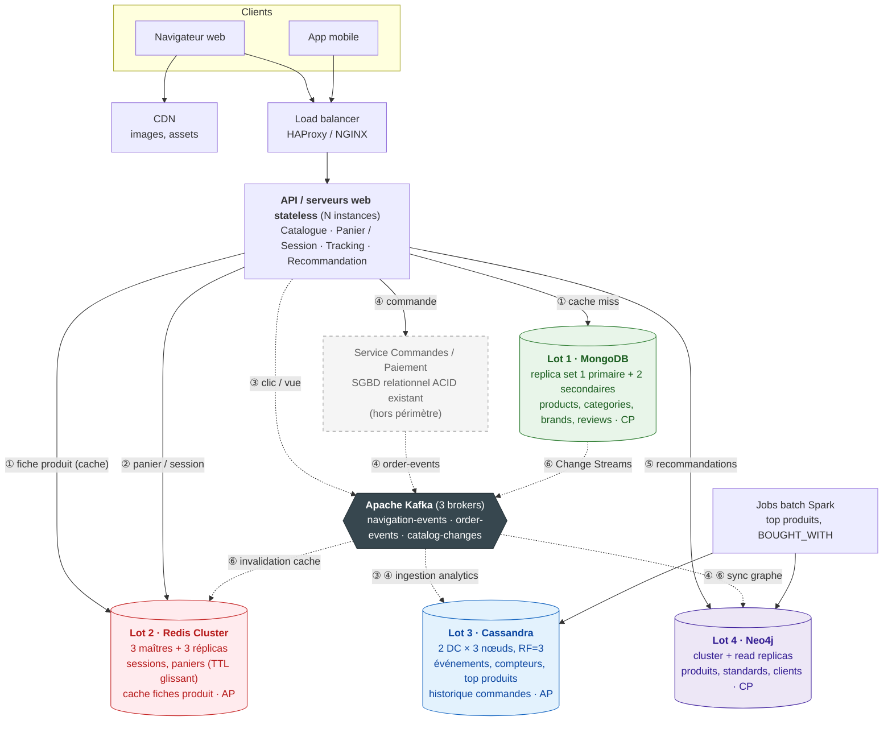

# Schéma d'architecture globale

Trait plein : appel synchrone. Pointillés : asynchrone (événements).

| Flux | Chemin |
|---|---|
| ① Fiche produit | API → cache Redis, sinon MongoDB (secondaire) |
| ② Panier / session | API ↔ Redis (TTL glissant, latence sub-ms) |
| ③ Clic / vue | API → Kafka `navigation-events` → Cassandra (asynchrone) |
| ④ Commande | API → service commandes → `order-events` → Cassandra (historique) + Neo4j (`PURCHASED`) |
| ⑤ Recommandations | API → Neo4j (read replicas) |
| ⑥ Évolution catalogue | Change Streams MongoDB → `catalog-changes` → Neo4j + invalidation du cache Redis |
