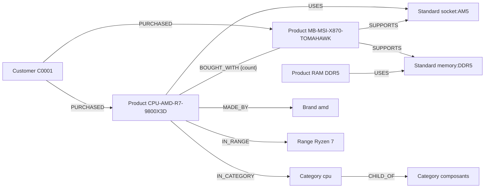

# Refonte de l'architecture de données LDLC — Document de conception

**Binôme :** `NOM Prénom` · `NOM Prénom` — **Date :** 18/11/2026

## 1. Contexte et hypothèses

LDLC remplace une base relationnelle monolithique qui sature. Les ordres de grandeur ci-dessous sont des **hypothèses de dimensionnement** (extrapolées du sujet), pas des chiffres officiels.

| Grandeur | Hypothèse | Conséquence |
|---|---|---|
| Références produits | 27 000, ~10 Ko/fiche | catalogue < 1 Go : tient en RAM (working set) |
| Marques | 600 | référentiel petit, quasi statique |
| Visites | ~10 M/mois (~330 k/jour) | lectures catalogue ≫ écritures |
| Événements de navigation | ~5 M/jour (~60/s moyen), pics ×10 aux sorties de composants | charge d'écriture continue et en rafales |
| Commandes | 25 000/jour (~0,3/s) | faible débit, mais historique sur 10 ans (~90 M commandes) |
| Sessions / paniers actifs | ~50 k sessions simultanées en pic, ~1 M paniers conservés | données chaudes, volatiles |

**Principes directeurs.**
- **Persistance polyglotte** : chaque lot a un profil d'accès différent, on choisit le modèle (document, clé-valeur, colonnes, graphe) qui le sert nativement.
- **Query-driven** : les schémas partent des requêtes métier (surtout Cassandra et Redis), pas des entités.
- **CAP / PACELC** : pour chaque base, on choisit explicitement ce qu'on sacrifie en cas de partition (P → A ou C) et en fonctionnement normal (E → latence ou cohérence), en fonction du **coût métier** d'une erreur.

## 2. Architecture globale

Schéma d'architecture globale (Mermaid) : [architecture.md](architecture.md).

| Flux | Description |
|---|---|
| ① Fiche produit | API → Redis `product:{sku}` (cache-aside, 300 s) → sur MISS MongoDB `products` |
| ② Panier / session | API → Redis `session:{sid}`, `cart:{cart_id}` (TTL glissant), serveurs web stateless |
| ③ Événements | navigateur → API (collecte) → Kafka `navigation-events` → consommateur → Cassandra (archive + compteurs) |
| ④ Commande | checkout → **service commandes** (SGBD relationnel ACID existant, hors périmètre : paiement, stock, facture) → outbox → Kafka `order-events` → Cassandra (historique) + Neo4j (`PURCHASED`, `BOUGHT_WITH`) |
| ⑤ Recommandations | API → Neo4j (lecture sur read replicas) |
| ⑥ Synchronisation catalogue | Change Streams MongoDB → Kafka `catalog-changes` → Neo4j (projection) + `DEL product:{sku}` dans Redis |

| Lot | Techno | Modèle | CAP (sous partition) | Justification métier |
|---|---|---|---|---|
| 1 Catalogue | MongoDB 8, replica set 3 nœuds | Document | CP (élection, écritures suspendues quelques s) | fiches hétérogènes, évolution sans migration, lectures massives |
| 2 Panier/sessions | Redis 7.4 Cluster 3+3 | Clé-valeur en mémoire | AP (réplication asynchrone) | latence < 1 ms, TTL natif, partage entre serveurs web |
| 3 Logs/analytics | Cassandra 5.0, 2 DC × 3, RF=3 | Colonnes larges | AP, cohérence réglable | écritures massives, rétention longue, scalabilité linéaire |
| 4 Recommandations | Neo4j 5.26 cluster | Graphe | CP (Raft) pour les écritures | parcours multi-sauts (achats, compatibilité) |

**Pourquoi pas une seule base ?** Les quatre besoins sont antagonistes : le catalogue veut un schéma souple et des filtres ad hoc, le panier une latence mémoire avec expiration, les logs un débit d'écriture append-only sur des téraoctets, les recommandations des jointures récursives. Une base unique (le monolithe actuel) optimise mal au moins trois d'entre eux. MongoDB seul, par exemple, ferait des sessions sur disque avec un index TTL purgé toutes les 60 s, et des recommandations en `$graphLookup` coûteux.

**Coût assumé du polyglotte.**
- *Exploitation* : 4 moteurs à superviser, sauvegarder et maîtriser. On limite le périmètre à des technologies standard et on garde le cœur transactionnel existant.
- *Cohérence inter-bases* : elle n'est qu'**à terme**. Le service commandes applique le **pattern outbox** (commande et message écrits dans la même transaction ACID, relais vers Kafka) : pas de double écriture perdue. Kafka garantit *at-least-once*, donc tous les consommateurs sont **idempotents** : clés naturelles (`order_id`, `event_id` timeuuid, SKU), `INSERT` Cassandra = upsert, `MERGE` Neo4j.
- *CQRS* : le modèle d'écriture des commandes reste relationnel. Cassandra n'en porte qu'un **modèle de lecture** (historique client, détail SAV), reconstructible par rejeu de `order-events`.

## 3. Lot 1 — Catalogue produits : MongoDB

**Pourquoi le document.** Une fiche est un agrégat lu d'un bloc, avec des attributs propres à chaque catégorie (socket d'un CPU, édition d'une licence).

| Alternative | Rejet |
|---|---|
| SQL en EAV | un filtre à N critères = N auto-jointures, typage perdu, contraintes inexploitables |
| SQL + JSONB | crédible, mais la montée en charge reste verticale (le problème actuel). MongoDB offre réplication et sharding natifs, un validateur de schéma partiel et l'agrégation |
| Cassandra | une table par requête : incompatible avec des filtres à facettes combinables arbitrairement |
| Clé-valeur | accès par clé seulement, aucun filtre ni index secondaire (on l'utilise comme **cache**) |

**Polymorphisme : deux documents de la même collection `products`.**

```js
{ _id: "CPU-AMD-R7-9800X3D", name: "AMD Ryzen 7 9800X3D (4.7 GHz / 5.2 GHz)", slug: "amd-ryzen-7-9800x3d",
  category: { _id: "cpu", name: "Processeurs", path: "informatique/composants/cpu" },
  brand: { _id: "amd", name: "AMD" }, range: "Ryzen 7", price: NumberDecimal("489.95"),
  stock: { status: "in_stock", qty: 42 },
  specs: [ { k: "socket", label: "Socket", v: "AM5" }, { k: "cores", label: "Cœurs", v: 8 },
           { k: "tdp", label: "TDP", v: 120, u: "W" } ],
  compat: { uses: ["socket:AM5"], supports: [] },
  compatible: [ { sku: "MB-MSI-X870-TOMAHAWK", name: "MSI MAG X870 TOMAHAWK WIFI" } ],  // ≤ 5, pour l'affichage
  rating: { avg: 4.8, count: 12, sum: 58 }, top_reviews: [ /* 3 avis les plus récents */ ],
  schema_version: 1, created_at: ISODate("2026-10-02T08:00:00Z"), updated_at: ISODate("2026-11-17T09:12:00Z") }

{ _id: "OS-MICROSOFT-WIN11-PRO", name: "Microsoft Windows 11 Professionnel 64 bits", slug: "windows-11-pro",
  category: { _id: "os", name: "Systèmes d'exploitation", path: "informatique/logiciels/os" },
  brand: { _id: "microsoft", name: "Microsoft" }, price: NumberDecimal("259.95"),
  stock: { status: "in_stock", qty: 999 },
  specs: [ { k: "edition", label: "Édition", v: "Professionnel" }, { k: "license", label: "Licence", v: "ESD" } ],
  delivery: { mode: "download", activation: "clé numérique" },   // champ propre aux logiciels
  compat: { uses: [], supports: [] }, rating: { avg: 0, count: 0, sum: 0 }, top_reviews: [], schema_version: 1 }
```

**Embedded ou référence.**

| Sous-élément | Choix | Raison |
|---|---|---|
| `specs` | **embedded** (tableau `k/v`) | toujours lu avec la fiche, borné (10 à 50), relation 1-à-quelques |
| `brand` | **extended reference** `{_id, name}` | 600 marques partagées, nom quasi immuable ; le détail reste dans `brands` |
| `category` | **extended reference** `{_id, name, path}` | fil d'Ariane sans jointure ; l'arbre vit dans `categories` |
| Avis | **référence** (collection `reviews`) + subset `top_reviews` + computed `rating` | 1-à-beaucoup **non borné** : l'embarquer gonflerait le document (limite 16 Mo, working set) alors que la fiche n'affiche que 3 avis |
| Produits compatibles | clés `compat.uses/supports` (vérité côté catalogue) + **subset embedded** `compatible: [{sku, name}]` (≤ 5, extended reference) ; la liste complète vient du graphe (Lot 4) | une liste complète embarquée est N×M : un nouveau boîtier ATX imposerait de réécrire des centaines de fiches (amplification d'écriture, listes périmées). Le subset de 5 suffit à la fiche, sans requête au graphe ; il est recalculé depuis les clés `compat` et peut être en retard, alors que le graphe fait foi pour la compatibilité complète (requête du Lot 4) |
| `stock` | **embedded**, instantané `{status, qty}` | affichage seulement ; la vérité reste dans le SI transactionnel, mise à jour par événement |

**Patterns appliqués.**

| Pattern | Où | Problème résolu |
|---|---|---|
| Polymorphic | `products` unique pour toutes les catégories | un seul index, une seule requête de liste, champs propres tolérés |
| Attribute | `specs: [{k, label, v, u}]` + index `{category._id, specs.k, specs.v}` | indexer des attributs inconnus à l'avance avec **un** index composé au lieu d'un index par attribut |
| Extended Reference | `brand`, `category` | éviter un `$lookup` sur la requête la plus fréquente |
| Subset | `top_reviews` (3 plus récents), `compatible` (≤ 5) | fiche légère ; avis complets dans `reviews`, compatibilité complète dans le graphe |
| Computed | `rating {avg, count, sum}` | moyenne maintenue à l'écriture (rare) plutôt que calculée à chaque lecture (fréquente) |
| Schema Versioning | `schema_version` | les formats coexistent, migration paresseuse à la réécriture |
| Array of Ancestors | `categories.ancestors` | sous-arbre en une requête indexée (`{ancestors: "composants"}`) |

**Validation et index.** Le schéma est ouvert mais pas anarchique. Le validateur impose le minimum vital, et `moderate` n'applique pas les règles aux documents anciens déjà invalides, ce qui laisse les versions de schéma coexister.

```js
db.createCollection("products", { validationLevel: "moderate", validator: { $jsonSchema: {
  bsonType: "object", required: ["name", "category", "brand", "price"],
  properties: { price: { bsonType: "decimal" }, specs: { bsonType: "array" } } } } })
```

Index `products` : `{category._id:1, price:1}` (liste triée par prix), `{category._id:1, specs.k:1, specs.v:1}` (facettes), `{brand._id:1}`, `{slug:1}` unique, texte `{name:"text"}`. Index `reviews` : `{product_id:1, created_at:-1}`. Index `categories` : `{ancestors:1}`.

**Requêtes types (mongosh).**

```js
// Filtre à facettes : CPU AM5, ≥ 8 cœurs, ≤ 600 €
db.products.find({ "category._id": "cpu", price: { $lte: NumberDecimal("600") },
  specs: { $all: [ { $elemMatch: { k: "socket", v: "AM5" } },
                   { $elemMatch: { k: "cores", v: { $gte: 8 } } } ] } }).sort({ price: 1 }).limit(20)

// Fiche produit (1 lecture par _id) + avis paginés
db.products.findOne({ _id: "CPU-AMD-R7-9800X3D" })
db.reviews.find({ product_id: "CPU-AMD-R7-9800X3D" }).sort({ created_at: -1 }).skip(0).limit(10)

// Compteurs de facettes d'une catégorie (panneau de filtres)
db.products.aggregate([ { $match: { "category._id": "cpu" } }, { $unwind: "$specs" },
  { $group: { _id: { k: "$specs.k", v: "$specs.v" }, n: { $sum: 1 } } }, { $sort: { "_id.k": 1, n: -1 } } ])

// Ajout d'un avis : insertion, puis mise à jour atomique du document produit (subset + computed)
db.reviews.insertOne(r)   // r = { _id, product_id, customer_id, author, rating: 5, title, comment, created_at }
const p = db.products.findOneAndUpdate({ _id: r.product_id },
  { $inc: { "rating.count": 1, "rating.sum": r.rating },
    $push: { top_reviews: { $each: [r], $sort: { created_at: -1 }, $slice: 3 } } },
  { returnDocument: "after" })
db.products.updateOne({ _id: p._id }, { $set: { "rating.avg": p.rating.sum / p.rating.count } })  // + DEL product:{sku}

// Évolution sans migration : nouvel attribut et nouvelle catégorie
db.products.insertOne({ _id: "GPU-NVIDIA-RTX5090", /* … */ specs: [ { k: "dlss", label: "DLSS", v: "4" } ] })
db.categories.insertOne({ _id: "vr", name: "Casques VR", parent: "peripheriques",
  ancestors: ["informatique", "peripheriques"], facets: [ { k: "refresh_rate", label: "Fréquence" } ] })
```

`$inc` et `$push` sur un même document sont atomiques. La seconde écriture (`avg`) est idempotente et recalculable : une coupure entre les deux laisse au pire une moyenne en retard d'un avis.

**Déploiement et compromis.**
- Replica set de 3 nœuds, écritures `w: "majority"` : un avis ou un prix acquitté survit à la perte du primaire.
- Navigation en `readPreference: secondaryPreferred` : on répartit la charge et on accepte quelques ms de retard de réplication. Le **prix au checkout** se lit sur le `primary` : le client paie le prix réel.
- Cache-aside Redis 300 s devant la lecture de fiche : ~0 lecture MongoDB pour les fiches chaudes. Invalidation par `DEL` à l'écriture et par le flux ⑥ ; 300 s bornent l'obsolescence si une invalidation est perdue.
- Limites : les `specs.v` hétérogènes (nombre ou texte) imposent des valeurs typées par clé côté application. La recherche plein texte (`$text`) reste basique (cf. §7).

## 4. Lot 2 — Paniers et sessions : Redis

**Pourquoi Redis.** Données en RAM (latence < 1 ms), TTL par clé natif, structures riches (Hash = panier ligne à ligne), réplication et cluster.

| Alternative | Rejet |
|---|---|
| Memcached | pas de structures (panier sérialisé en entier à chaque ligne), pas de persistance ni de réplication |
| Sessions en base (SQL / MongoDB) | aller-retour disque, purge des expirés à programmer, charge sur la base métier |
| Sessions locales + sticky sessions | perte de session à chaque redéploiement ou panne de serveur, répartition de charge déséquilibrée |

**Modèle de clés (contrat).**

| Clé | Type | TTL | Contenu |
|---|---|---|---|
| `session:{sid}` | Hash | 1 800 s glissant | `customer_id` ("" si anonyme), `cart_id`, `created_at`, `last_seen` |
| `cart:{cart_id}` | Hash | 7 j anonyme / 30 j client, glissant | champ = SKU, valeur = quantité |
| `product:{sku}` | String (JSON) | 300 s | cache-aside fiche produit |

`cart_id` = `anon:{uuid4 hex}` ou `customer:{customer_id}`. Le panier d'un client connecté est donc indexé par client : il le retrouve sur un autre appareil.

**Hash plutôt que JSON.** `HINCRBY` modifie une ligne en O(1) sans lire-modifier-réécrire tout le panier, donc sans course entre deux onglets. Les petits Hash sont encodés en *listpack*, très compacts. Le produit en cache reste une String JSON, parce qu'il est toujours lu et écrit d'un bloc.

**TTL glissant.** Chaque accès repose `EXPIRE` : la session meurt après 30 min d'inactivité, le panier après 7 ou 30 jours. Aucun job de purge n'est nécessaire.

```redis
HSET session:9f2c customer_id "" cart_id anon:4be1 created_at 2026-11-18T10:00Z last_seen 2026-11-18T10:00Z
EXPIRE session:9f2c 1800
MULTI                                   # ajout au panier + rafraîchissement des TTL
HINCRBY cart:anon:4be1 CPU-AMD-R7-9800X3D 1
EXPIRE cart:anon:4be1 604800
EXPIRE session:9f2c 1800
EXEC
HGETALL cart:anon:4be1                  # lecture du panier (enrichi ensuite par MongoDB : nom, prix courant)
# Login : fusion ligne à ligne puis bascule de la session
HINCRBY cart:customer:C0001 CPU-AMD-R7-9800X3D 1      # pour chaque champ du panier anonyme
DEL cart:anon:4be1
HSET session:9f2c customer_id C0001 cart_id customer:C0001
EXPIRE cart:customer:C0001 2592000
```

**Dimensionnement.** ~1 M paniers × 0,5 Ko + 50 k sessions × 0,3 Ko + 27 k fiches × 10 Ko ≈ **0,8 Go**. Trois maîtres suffisent largement ; le cluster sert la disponibilité plus que la capacité. L'environnement local (Docker Compose) est limité à `maxmemory 256mb`.

**Persistance et éviction.** `appendonly yes` + `appendfsync everysec` : au pire 1 s d'écritures perdues au redémarrage. `maxmemory-policy volatile-ttl` : toutes les clés ont un TTL, et sous pression mémoire Redis évince d'abord celles dont le TTL restant est le plus court. L'ordre suit la valeur métier : le cache produit (≤ 300 s, reconstructible depuis MongoDB) part en premier, puis les sessions (≤ 30 min), et les paniers (7 à 30 j) en dernier. On ne perd donc un panier qu'en ultime recours, sans jamais refuser d'écriture.

**Redis Cluster.** 16 384 hash slots répartis sur 3 maîtres, chacun avec un réplica. `cart:anon:…` et `cart:customer:…` tombent dans des slots différents : la fusion au login **n'est pas atomique** (pas de `MULTI` multi-slots, et un hash tag commun est impossible puisque les deux identifiants sont indépendants). Pire cas, une interruption au milieu de la fusion double une quantité, ce que le client voit et corrige avant de payer. Un panier n'est pas une commande, le risque est donc accepté.

**CAP / PACELC : AP, PA/EL.** La réplication maître→réplica est asynchrone : lors d'un basculement, les dernières écritures acquittées peuvent être perdues (une ligne de panier, une session à recréer). Justification métier : un panier se reconstruit en un clic, alors qu'une latence ou une indisponibilité au moment d'ajouter un article coûte une vente. Le paiement, lui, ne lit jamais Redis comme source de vérité : le service commandes revalide prix et stock. Les serveurs web sont **stateless** (identifiant de session porté par un cookie) et s'ajoutent derrière le load balancer sans affinité.

## 5. Lot 3 — Logs, analytics et historique : Cassandra

**Pourquoi Cassandra.**
- Écritures en LSM-tree (commit log séquentiel + memtable) : chaque clic est une écriture bon marché.
- Architecture sans maître et scalabilité linéaire : on ajoute des nœuds.
- TTL par ligne + **TimeWindowCompactionStrategy** : les fenêtres expirées sont supprimées en bloc. Fenêtre de 7 jours, soit ~57 SSTables sur 13 mois (cible : quelques dizaines ; une fenêtre d'un jour en donnerait ~400).
- Réplication multi-DC native.

Volumétrie brute : 5 M × ~400 o × 396 j ≈ 0,8 To, soit ~2,4 To par DC avec RF=3.

| Alternative | Rejet |
|---|---|
| MongoDB time series | adapté, mais les écritures passent par un seul primaire par shard et le multi-DC actif-actif manque |
| Elasticsearch | excellent pour la recherche dans les logs, mais coûteux en stockage indexé sur 13 mois, et la durabilité n'est pas sa vocation |
| Entrepôt (BigQuery, ClickHouse…) | idéal pour l'**ad hoc**, mais ne sert pas des lectures unitaires temps réel (historique client) ; il est prévu en aval (data lake, §7) |

Cassandra impose le **query-driven** : une table par requête, des données dupliquées, et aucune requête hors clé.

| Requête | Table | Clé de partition → accès |
|---|---|---|
| Q1 vues d'un produit un jour / sur N jours | `product_views_by_day` | `sku`, tranche sur `day` |
| Q2 top produits du jour / de la semaine | `top_products_by_period` (alimentée depuis `daily_views_by_shard`) | `period`, lecture des N premiers `rank` |
| Q3 historique des commandes d'un client | `orders_by_customer` | `customer_id`, plus récentes d'abord |
| Détail d'une commande (SAV) | `orders_by_id` | `order_id` |
| Top recherches du jour | `searches_by_day` | `(day, shard)` × 8 shards, fusion des 8 partitions et tri en mémoire |
| Parcours d'une session | `events_by_session` | `session_id`, ordre chronologique |
| Archive brute (batch, rejeu) | `events_by_hour` | `(day, hour, shard)` |

**Annotation des clés (notation Chebotko : K = partition, C↑/C↓ = clustering, ++ = compteur).**

| Table | K | C | Colonnes | TTL |
|---|---|---|---|---|
| `events_by_hour` | day, hour, shard | event_id ↓ | event_type, session_id, customer_id, sku, url, search_query | 396 j |
| `events_by_session` | session_id | event_id ↑ | event_type, customer_id, sku, url, search_query | 90 j |
| `product_views_by_day` | sku | day ↓ | views ++ | — |
| `daily_views_by_shard` | day, shard | sku ↑ | views ++ | — |
| `searches_by_day` | day, shard | search_query ↑ | searches ++ | — |
| `top_products_by_period` | period | rank ↑ | sku, views, computed_at | — |
| `orders_by_customer` | customer_id | order_date ↓, order_id ↑ | status, total, items | — |
| `orders_by_id` | order_id | — | customer_id, order_date, status, total, items | — |

```sql
CREATE TABLE ldlc.events_by_hour (
  day date, hour tinyint, shard tinyint, event_id timeuuid,
  event_type text, session_id text, customer_id text, sku text, url text, search_query text,
  PRIMARY KEY ((day, hour, shard), event_id)
) WITH CLUSTERING ORDER BY (event_id DESC)
  AND compaction = {'class': 'TimeWindowCompactionStrategy', 'compaction_window_unit': 'DAYS', 'compaction_window_size': 7}
  AND default_time_to_live = 34214400;                          -- 396 j ≈ 13 mois

CREATE TABLE ldlc.product_views_by_day (sku text, day date, views counter,
  PRIMARY KEY ((sku), day)) WITH CLUSTERING ORDER BY (day DESC);

CREATE TYPE ldlc.order_line (sku text, name text, quantity int, unit_price decimal);
CREATE TABLE ldlc.orders_by_customer (
  customer_id text, order_date timestamp, order_id text,
  status text, total decimal, items list<frozen<order_line>>,
  PRIMARY KEY ((customer_id), order_date, order_id)
) WITH CLUSTERING ORDER BY (order_date DESC, order_id ASC);
```

Le schéma complet est dans `db/cassandra/schema.cql`. Keyspace de production : `NetworkTopologyStrategy {'dc_paris': 3, 'dc_lyon': 3}`.

**Taille des partitions (cible < 100 k lignes, < 100 Mo).**
- `events_by_hour` : 5 M / 24 h / 8 shards ≈ **26 k lignes** (~10 Mo) en moyenne. En pic ×10 sur une heure, on monte à ~260 k : en production, on passe à **32 shards** (≈ 65 k en pic). `shard = crc32(session_id) % N` répartit la charge sur N nœuds au lieu d'une partition chaude par heure (**write sharding**).
- `daily_views_by_shard` : 27 000 SKU / 8 ≈ 3,4 k lignes ; le shard `crc32(sku) % 8` évite que tous les compteurs d'un jour pèsent sur une seule partition. `searches_by_day` suit le même principe avec `shard = crc32(search_query) % 8` ; la longue traîne des requêtes est bornée par la journée.
- `product_views_by_day` : 365 lignes par an et par produit. `top_products_by_period` : ≤ 100 lignes.
- `orders_by_customer` : quelques dizaines de commandes par particulier, partition bornée. Pour un client B2B (milliers de commandes), on ajouterait un bucket `year` à la clé de partition.

**Compteurs.** Un `product_view` incrémente `product_views_by_day` **et** `daily_views_by_shard` ; un `search` incrémente `searches_by_day`. Limites des `counter` :
- pas de TTL ;
- table réservée aux compteurs ;
- incrément **non idempotent** : un retry après timeout peut compter deux fois, et un rejeu double tout. Tout chargement initial doit donc être protégé par un marqueur (exécution unique).

Les vues sont donc une mesure **approximative**, ce qui suffit pour un classement et des statistiques d'audience. Le consommateur Kafka **pré-agrège** par micro-lot (`+n` toutes les secondes au lieu de n × `+1`), ce qui divise les écritures et les retries. En cas de dérive, un job batch recalcule les vues exactes depuis `events_by_hour`.

**Top-N.** Un job (toutes les 5 min) lit les 8 partitions `daily_views_by_shard` du jour, ou 7 × 8 pour la semaine, trie en mémoire et **upserte** les rangs 1 à 100 de `period = 'day:2026-11-18' | 'week:2026-W47'`. On écrase des rangs fixes au lieu de supprimer puis réinsérer : **aucune tombstone**. La lecture est une simple tranche de partition.

**Commandes.** Les deux tables sont écrites dans un **`BATCH` loggé** : l'atomicité est garantie à terme (les deux ou aucune), sans isolation. Ce n'est pas une optimisation de performance. Les rejeux Kafka sont sans effet : même clé primaire, donc upsert.

**Cohérence réglable.**
- Événements : `LOCAL_ONE`. Perdre un clic est tolérable, la latence et la disponibilité d'écriture priment.
- Commandes : `LOCAL_QUORUM` en écriture **et** en lecture : R + W = 2 + 2 > RF = 3, donc le client relit toujours sa commande dans son DC, sans attendre le DC distant.

**Rétention.**
- Logs bruts : TTL 13 mois. La CNIL limite les traceurs de mesure d'audience à 13 mois et les données collectées à 25 mois ; 13 mois permettent aussi la comparaison N-1.
- Agrégats (anonymes) : conservés.
- Commandes : **10 ans** (obligation de conservation des pièces comptables).
- Parcours de session : 90 jours.

**Anti-patterns évités.** Pas d'`ALLOW FILTERING` ni d'index secondaire : chaque requête cible une partition. Pas de partition non bornée : buckets temporels et shards. Pas d'usage en file d'attente ni de `DELETE` massif générateur de tombstones : expiration par TTL + TWCS, upsert de rangs.

**Requêtes types (CQL).**

```sql
-- Ingestion d'un product_view (pré-agrégé par le consommateur)
INSERT INTO ldlc.events_by_hour (day, hour, shard, event_id, event_type, session_id, sku)
  VALUES ('2026-11-18', 14, 3, now(), 'product_view', '9f2c', 'CPU-AMD-R7-9800X3D');
UPDATE ldlc.product_views_by_day SET views = views + 1 WHERE sku = 'CPU-AMD-R7-9800X3D' AND day = '2026-11-18';
UPDATE ldlc.daily_views_by_shard SET views = views + 1 WHERE day = '2026-11-18' AND shard = 5 AND sku = 'CPU-AMD-R7-9800X3D';
-- Q1 : vues aujourd'hui, puis série sur 7 jours
SELECT views FROM ldlc.product_views_by_day WHERE sku = 'CPU-AMD-R7-9800X3D' AND day = '2026-11-18';
SELECT day, views FROM ldlc.product_views_by_day WHERE sku = 'CPU-AMD-R7-9800X3D' AND day >= '2026-11-12';
-- Q2 : top 10 de la semaine
SELECT rank, sku, views FROM ldlc.top_products_by_period WHERE period = 'week:2026-W47' LIMIT 10;
-- Top recherches du jour : 8 partitions lues, fusion et tri côté application
SELECT search_query, searches FROM ldlc.searches_by_day WHERE day = '2026-11-18' AND shard = 0;  -- … shard 7
-- Q3 : 20 dernières commandes d'un client
SELECT order_date, order_id, status, total FROM ldlc.orders_by_customer WHERE customer_id = 'C0001' LIMIT 20;
-- Enregistrement d'une commande
BEGIN BATCH
  INSERT INTO ldlc.orders_by_customer (customer_id, order_date, order_id, status, total, items) VALUES (...);
  INSERT INTO ldlc.orders_by_id (order_id, customer_id, order_date, status, total, items) VALUES (...);
APPLY BATCH;
```

## 6. Lot 4 — Recommandations : Neo4j

**Pourquoi le graphe.** Les cas d'usage sont des **parcours** : client → produit → client → produit, produit → standard → produit. Neo4j stocke les relations comme des pointeurs (*index-free adjacency*) : un saut coûte O(degré local), quelle que soit la taille totale de la base. En SQL, chaque saut est une jointure (requêtes récursives `WITH RECURSIVE` qui explosent à 3 sauts). En MongoDB, `$graphLookup` ne suit qu'un type de lien, sans filtrage ni scoring riche en cours de parcours. Cypher exprime aussi directement des motifs (« même standard, rôles opposés »).

**Modèle.**

| Élément | Propriétés | Rôle |
|---|---|---|
| `Product` | `sku` (unique), `name`, `price`, `category`, `brand` | nœud central (copie dénormalisée pour filtrer sans saut) |
| `Category`, `Brand`, `Range` | `id`/`name` | similarité (même catégorie, marque, gamme) ; `CHILD_OF` pour l'arbre |
| `Standard` | `id` (= clé de compat, ex. `socket:AM5`), `kind`, `name` | pivot de compatibilité |
| `Customer` | `id` seulement (pseudonyme) | filtrage collaboratif |
| `IN_CATEGORY`, `MADE_BY`, `IN_RANGE`, `USES`, `SUPPORTS` | — | structure catalogue (projection MongoDB) |
| `PURCHASED` | `order_id`, `date`, `quantity` | historique d'achat |
| `BOUGHT_WITH` | `count` | co-achat dans une même commande, pré-calculé ; stockée **une seule fois**, orientée du SKU le plus petit vers le plus grand (`a.sku < b.sku`), interrogée sans direction |



**Compatibilité par nœuds `Standard`.** A est compatible avec B si un standard S vérifie `(A)-[:USES]->(S)<-[:SUPPORTS]-(B)`, ou l'inverse. Un nouveau produit crée **une arête par standard** (2 à 4) au lieu de centaines d'arêtes produit↔produit (modèle N×M). La règle est déclarative et toujours à jour. Une carte mère et un ventirad qui *supportent* tous deux AM5 ne sont pas déclarés compatibles entre eux, grâce à `type(r1) <> type(r2)`.

**Requêtes types (Cypher).**

```cypher
// « Ont aussi acheté » : 2 sauts via les clients, filtre de catégorie optionnel
MATCH (p:Product {sku: $sku})<-[:PURCHASED]-(c:Customer)-[:PURCHASED]->(o:Product)
WHERE o <> p AND ($category IS NULL OR o.category = $category)
RETURN o.sku, o.name, count(DISTINCT c) AS buyers ORDER BY buyers DESC LIMIT 5;

// Achetés ensemble (pré-calculé, 1 saut)
MATCH (:Product {sku: $sku})-[r:BOUGHT_WITH]-(o:Product)
RETURN o.sku, o.name, r.count ORDER BY r.count DESC LIMIT 5;

// Compatibles avec ce boîtier (form_factor, psu_format…)
MATCH (a:Product {sku: $sku})-[r1:USES|SUPPORTS]->(s:Standard)<-[r2:USES|SUPPORTS]-(b:Product)
WHERE type(r1) <> type(r2) AND ($category IS NULL OR b.category = $category)
RETURN b.category, b.sku, b.name, collect(s.id) AS via ORDER BY b.category;

// Similaires : même catégorie, score marque + gamme + standards communs
MATCH (p:Product {sku: $sku})-[:IN_CATEGORY]->(:Category)<-[:IN_CATEGORY]-(o:Product) WHERE o <> p
OPTIONAL MATCH (p)-[:MADE_BY]->(b)<-[:MADE_BY]-(o)
OPTIONAL MATCH (p)-[:IN_RANGE]->(r)<-[:IN_RANGE]-(o)
OPTIONAL MATCH (p)-[:USES|SUPPORTS]->(s:Standard)<-[:USES|SUPPORTS]-(o)
WITH p, o, 2 * count(DISTINCT b) + 3 * count(DISTINCT r) + count(DISTINCT s) AS score
RETURN o.sku, o.name, score ORDER BY score DESC, abs(o.price - p.price) LIMIT 5;

// Filtrage collaboratif personnalisé (3 sauts, « amis d'amis »)
MATCH (me:Customer {id: $cid})-[:PURCHASED]->(:Product)<-[:PURCHASED]-(peer:Customer)-[:PURCHASED]->(reco:Product)
WHERE peer <> me AND NOT (me)-[:PURCHASED]->(reco)
RETURN reco.sku, reco.name, count(DISTINCT peer) AS score ORDER BY score DESC LIMIT 5;
```

**Supernœuds.** Un best-seller ou `socket:AM5` peut porter des dizaines de milliers d'arêtes, et les parcours à travers eux explosent. Parades :
- **pré-calculer** `BOUGHT_WITH` (lecture en 1 saut) ;
- borner les parcours (`LIMIT`, fenêtre de dates sur `PURCHASED`) ;
- filtrer tôt sur `category`, dénormalisée sur `Product` ;
- recalculer de nuit les scores lourds.

**Synchronisation.** Neo4j est une **projection** du catalogue, pas une source de vérité.
- *Catalogue* (flux ⑥) : les Change Streams MongoDB (reprise sur `resumeToken`) alimentent `catalog-changes`. Le consommateur fait `MERGE (p:Product {sku})` + `SET`, puis remplace les arêtes `USES/SUPPORTS`.
- *Commandes* (flux ④) : `MERGE (c)-[:PURCHASED {order_id}]->(p)`. Pour chaque paire de la commande, `MERGE (a)-[w:BOUGHT_WITH]->(b)` avec `a.sku < b.sku` (pas de doublon A→B / B→A), puis `count + 1`, appliqué seulement si `PURCHASED` vient d'être créée (`ON CREATE`). Le consommateur reste ainsi idempotent malgré l'*at-least-once*. Un recalcul complet (batch) pose `count` par `SET` à partir de l'historique, ce qui le rend idempotent par construction.

Les contraintes d'unicité (`Product.sku`, `Standard.id`…) garantissent l'absence de doublons et servent d'index au `MERGE`.

**CAP.**
- Écritures : primaires répliquées par **Raft** (CP), un commit exige la majorité.
- Lectures de recommandations : **read replicas** asynchrones (EL). Les *bookmarks* donnent une cohérence causale (lire ses propres écritures) quand c'est utile.
- Une recommandation périmée de quelques secondes est sans conséquence. Si Neo4j est indisponible, l'API se replie sur le top ventes Cassandra (`top_products_by_period`) : la page s'affiche toujours.
- **RGPD** : `Customer` ne porte qu'un identifiant pseudonyme, aucune donnée personnelle. L'effacement d'un client se fait par `DETACH DELETE`.

## 7. Synthèse des compromis

| Techno | CAP | PACELC | Réglage retenu | Risque accepté |
|---|---|---|---|---|
| MongoDB | CP | PC/EC (écritures), EL (navigation) | `w: majority`, `secondaryPreferred` sauf prix au checkout (`primary`) | écritures suspendues ~10 s pendant une élection ; fiche périmée ≤ 300 s via le cache |
| Redis Cluster | AP | PA/EL | réplication asynchrone, AOF `everysec`, `volatile-ttl` | perte des dernières lignes de panier au basculement ; fusion au login non atomique |
| Cassandra | AP (réglable) | PA/EL (événements), PC/EC local (commandes) | `LOCAL_ONE` / `LOCAL_QUORUM`, RF=3 × 2 DC, BATCH loggé | compteurs approximatifs ; agrégats en retard de 5 min |
| Neo4j | CP (Raft) | PC/EC (primaires), EL (replicas) | lectures sur replicas, bookmarks si besoin | recommandations en retard de quelques secondes ; repli sur le top ventes |
| Kafka | CP | — | `acks=all`, `min.insync.replicas=2`, consommateurs idempotents | doublons (absorbés par l'idempotence), délai de propagation |

**Risques et limites.**
- Complexité d'exploitation de 4 moteurs, qui demande des compétences, de la supervision et des sauvegardes par moteur.
- Cohérence inter-bases à terme seulement : un produit créé apparaît dans les recommandations après le délai de propagation.
- Pas de recherche plein texte de qualité (pertinence, fautes de frappe, synonymes).
- Les analyses ad hoc sont hors de portée de Cassandra.

**Évolutions.**
- **OpenSearch** alimenté par le même flux ⑥ pour la recherche et l'autocomplétion.
- **Data lake** (Kafka → Parquet sur stockage objet → Spark/Trino) pour l'analytique ad hoc et le recalcul exact des compteurs.
- **Neo4j GDS** (Node Similarity, Louvain pour les communautés d'acheteurs, PageRank) pour des recommandations plus fines, calculées hors ligne.
