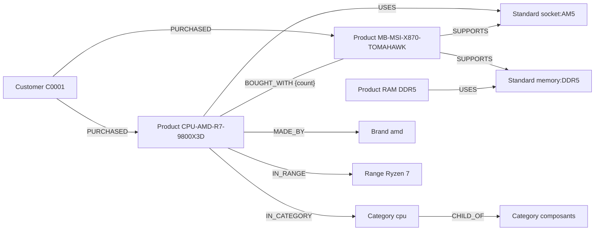

# Lot 4 — Recommandations produits

> Besoin et contraintes : voir [sujet](../sujet.md).

## Choix technologique

**Neo4j 5.26 en cluster** — modèle graphe, CP (Raft) pour les écritures. Place dans l'architecture : voir le [schéma d'architecture](../../architecture/README.md) (flux ④ commande, ⑤ recommandations, ⑥ synchronisation catalogue) et la [synthèse](00-contexte-synthese.md).

| Lot | Techno | Modèle | CAP (sous partition) | Justification métier |
|---|---|---|---|---|
| 4 Recommandations | Neo4j 5.26 cluster | Graphe | CP (Raft) pour les écritures | parcours multi-sauts (achats, compatibilité) |

**Pourquoi le graphe.** Les cas d'usage sont des **parcours** : client → produit → client → produit, produit → standard → produit. Neo4j stocke les relations comme des pointeurs (*index-free adjacency*) : un saut coûte O(degré local), quelle que soit la taille totale de la base. En SQL, chaque saut est une jointure (requêtes récursives `WITH RECURSIVE` qui explosent à 3 sauts). En MongoDB, `$graphLookup` ne suit qu'un type de lien, sans filtrage ni scoring riche en cours de parcours. Cypher exprime aussi directement des motifs (« même standard, rôles opposés »).

## Schéma de données

| Élément | Propriétés | Rôle |
|---|---|---|
| `Product` | `sku` (unique), `name`, `price`, `category`, `brand` | nœud central (copie dénormalisée pour filtrer sans saut) |
| `Category`, `Brand`, `Range` | `id`/`name` | similarité (même catégorie, marque, gamme) ; `CHILD_OF` pour l'arbre |
| `Standard` | `id` (= clé de compat, ex. `socket:AM5`), `kind`, `name` | pivot de compatibilité |
| `Customer` | `id` seulement (pseudonyme) | filtrage collaboratif |
| `IN_CATEGORY`, `MADE_BY`, `IN_RANGE`, `USES`, `SUPPORTS` | — | structure catalogue (projection MongoDB) |
| `PURCHASED` | `order_id`, `date`, `quantity` | historique d'achat |
| `BOUGHT_WITH` | `count` | co-achat dans une même commande, pré-calculé ; stockée **une seule fois**, orientée du SKU le plus petit vers le plus grand (`a.sku < b.sku`), interrogée sans direction |

**Compatibilité par nœuds `Standard`.** A est compatible avec B si un standard S vérifie `(A)-[:USES]->(S)<-[:SUPPORTS]-(B)`, ou l'inverse. Un nouveau produit crée **une arête par standard** (2 à 4) au lieu de centaines d'arêtes produit↔produit (modèle N×M). La règle est déclarative et toujours à jour. Une carte mère et un ventirad qui *supportent* tous deux AM5 ne sont pas déclarés compatibles entre eux, grâce à `type(r1) <> type(r2)`.

## Requêtes types

_À compléter._

## Justification des compromis

_À compléter (CAP, patterns, Query-Driven)._
