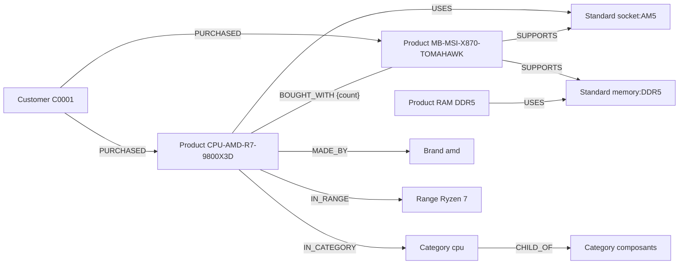

# Lot 4 — Recommandations produits

> Besoin et contraintes : voir [sujet](../sujet.md).

## Choix technologique

**Neo4j 5.26 en cluster** — modèle graphe, CP (Raft) pour les écritures. Place dans l'architecture : voir le [schéma d'architecture](../../architecture/README.md) (flux ④ commande, ⑤ recommandations, ⑥ synchronisation catalogue) et la [synthèse](00-contexte-synthese.md).

| Lot | Techno | Modèle | CAP (sous partition) | Justification métier |
|---|---|---|---|---|
| 4 Recommandations | Neo4j 5.26 cluster | Graphe | CP (Raft) pour les écritures | parcours multi-sauts (achats, compatibilité) |

**Pourquoi le graphe.** Les cas d'usage sont des **parcours** : client → produit → client → produit, produit → standard → produit. Neo4j stocke les relations comme des pointeurs (*index-free adjacency*) : un saut coûte O(degré local), quelle que soit la taille totale de la base. En SQL, chaque saut est une jointure (requêtes récursives `WITH RECURSIVE` qui explosent à 3 sauts). En MongoDB, `$graphLookup` ne suit qu'un type de lien, sans filtrage ni scoring riche en cours de parcours. Cypher exprime aussi directement des motifs (« même standard, rôles opposés »).

## Schéma de données

| Élément | Propriétés | Rôle |
|---|---|---|
| `Product` | `sku` (unique), `name`, `price`, `category`, `brand` | nœud central (copie dénormalisée pour filtrer sans saut) |
| `Category`, `Brand`, `Range` | `id`/`name` | similarité (même catégorie, marque, gamme) ; `CHILD_OF` pour l'arbre |
| `Standard` | `id` (= clé de compat, ex. `socket:AM5`), `kind`, `name` | pivot de compatibilité |
| `Customer` | `id` seulement (pseudonyme) | filtrage collaboratif |
| `IN_CATEGORY`, `MADE_BY`, `IN_RANGE`, `USES`, `SUPPORTS` | — | structure catalogue (projection MongoDB) |
| `PURCHASED` | `order_id`, `date`, `quantity` | historique d'achat |
| `BOUGHT_WITH` | `count` | co-achat dans une même commande, pré-calculé ; stockée **une seule fois**, orientée du SKU le plus petit vers le plus grand (`a.sku < b.sku`), interrogée sans direction |



**Compatibilité par nœuds `Standard`.** A est compatible avec B si un standard S vérifie `(A)-[:USES]->(S)<-[:SUPPORTS]-(B)`, ou l'inverse. Un nouveau produit crée **une arête par standard** (2 à 4) au lieu de centaines d'arêtes produit↔produit (modèle N×M). La règle est déclarative et toujours à jour. Une carte mère et un ventirad qui *supportent* tous deux AM5 ne sont pas déclarés compatibles entre eux, grâce à `type(r1) <> type(r2)`.

**Contraintes et index.** Les contraintes d'unicité (`Product.sku`, `Standard.id`…) garantissent l'absence de doublons et servent d'index au `MERGE`. Script complet : [`db/neo4j/schema.cypher`](../../db/neo4j/schema.cypher).

## Requêtes types

```cypher
// « Ont aussi acheté » : 2 sauts via les clients, filtre de catégorie optionnel
MATCH (p:Product {sku: $sku})<-[:PURCHASED]-(c:Customer)-[:PURCHASED]->(o:Product)
WHERE o <> p AND ($category IS NULL OR o.category = $category)
RETURN o.sku, o.name, count(DISTINCT c) AS buyers ORDER BY buyers DESC LIMIT 5;

// Achetés ensemble (pré-calculé, 1 saut)
MATCH (:Product {sku: $sku})-[r:BOUGHT_WITH]-(o:Product)
RETURN o.sku, o.name, r.count ORDER BY r.count DESC LIMIT 5;

// Compatibles avec ce boîtier (form_factor, psu_format…)
MATCH (a:Product {sku: $sku})-[r1:USES|SUPPORTS]->(s:Standard)<-[r2:USES|SUPPORTS]-(b:Product)
WHERE type(r1) <> type(r2) AND ($category IS NULL OR b.category = $category)
RETURN b.category, b.sku, b.name, collect(s.id) AS via ORDER BY b.category;

// Similaires : même catégorie, score marque + gamme + standards communs
MATCH (p:Product {sku: $sku})-[:IN_CATEGORY]->(:Category)<-[:IN_CATEGORY]-(o:Product) WHERE o <> p
OPTIONAL MATCH (p)-[:MADE_BY]->(b)<-[:MADE_BY]-(o)
OPTIONAL MATCH (p)-[:IN_RANGE]->(r)<-[:IN_RANGE]-(o)
OPTIONAL MATCH (p)-[:USES|SUPPORTS]->(s:Standard)<-[:USES|SUPPORTS]-(o)
WITH p, o, 2 * count(DISTINCT b) + 3 * count(DISTINCT r) + count(DISTINCT s) AS score
RETURN o.sku, o.name, score ORDER BY score DESC, abs(o.price - p.price) LIMIT 5;

// Filtrage collaboratif personnalisé (3 sauts, « amis d'amis »)
MATCH (me:Customer {id: $cid})-[:PURCHASED]->(:Product)<-[:PURCHASED]-(peer:Customer)-[:PURCHASED]->(reco:Product)
WHERE peer <> me AND NOT (me)-[:PURCHASED]->(reco)
RETURN reco.sku, reco.name, count(DISTINCT peer) AS score ORDER BY score DESC LIMIT 5;
```

Script complet, exécutable sur les données de démonstration (valeurs littérales, lecture seule) : [`db/neo4j/queries.cypher`](../../db/neo4j/queries.cypher).

## Justification des compromis

**Déploiement.** Neo4j 5.26 en cluster. Neo4j est une **projection** du catalogue et des commandes, pas une source de vérité : il se reconstruit par rejeu de `catalog-changes` et `order-events` (voir la [synthèse](00-contexte-synthese.md) et le [schéma d'architecture](../../architecture/README.md)).

**Supernœuds.** Un best-seller ou `socket:AM5` peut porter des dizaines de milliers d'arêtes, et les parcours à travers eux explosent. Parades :
- **pré-calculer** `BOUGHT_WITH` (lecture en 1 saut) ;
- borner les parcours (`LIMIT`, fenêtre de dates sur `PURCHASED`) ;
- filtrer tôt sur `category`, dénormalisée sur `Product` ;
- recalculer de nuit les scores lourds.

**Synchronisation.** Neo4j est une **projection** du catalogue, pas une source de vérité.
- *Catalogue* (flux ⑥) : les Change Streams MongoDB (reprise sur `resumeToken`) alimentent `catalog-changes`. Le consommateur fait `MERGE (p:Product {sku})` + `SET`, puis remplace les arêtes `USES/SUPPORTS`.
- *Commandes* (flux ④) : `MERGE (c)-[:PURCHASED {order_id}]->(p)`. Pour chaque paire de la commande, `MERGE (a)-[w:BOUGHT_WITH]->(b)` avec `a.sku < b.sku` (pas de doublon A→B / B→A), puis `count + 1`, appliqué seulement si `PURCHASED` vient d'être créée (`ON CREATE`). Le consommateur reste ainsi idempotent malgré l'*at-least-once*. Un recalcul complet (batch) pose `count` par `SET` à partir de l'historique, ce qui le rend idempotent par construction.

**CAP.**
- Écritures : primaires répliquées par **Raft** (CP), un commit exige la majorité.
- Lectures de recommandations : **read replicas** asynchrones (EL). Les *bookmarks* donnent une cohérence causale (lire ses propres écritures) quand c'est utile.
- Une recommandation périmée de quelques secondes est sans conséquence. Si Neo4j est indisponible, l'API se replie sur le top ventes Cassandra (`top_products_by_period`) : la page s'affiche toujours.

| Techno | CAP | PACELC | Réglage retenu | Risque accepté |
|---|---|---|---|---|
| Neo4j | CP (Raft) | PC/EC (primaires), EL (replicas) | lectures sur replicas, bookmarks si besoin | recommandations en retard de quelques secondes ; repli sur le top ventes |

**RGPD.** `Customer` ne porte qu'un identifiant pseudonyme, aucune donnée personnelle. L'effacement d'un client se fait par `DETACH DELETE`.

**Risques et limites.** Cohérence inter-bases à terme seulement : un produit créé apparaît dans les recommandations après le délai de propagation. Évolution possible : **Neo4j GDS** (Node Similarity, Louvain pour les communautés d'acheteurs, PageRank) pour des recommandations plus fines, calculées hors ligne.
